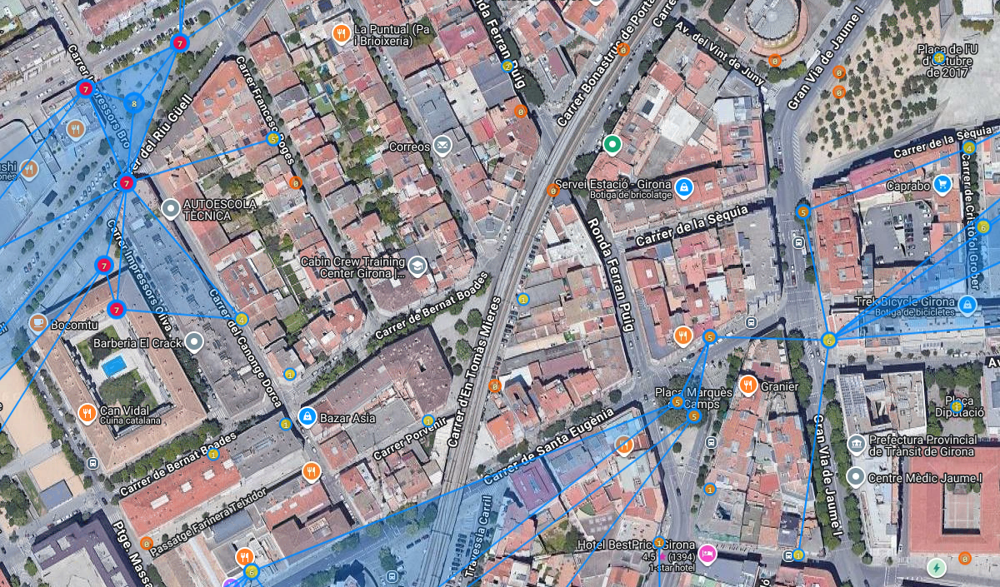
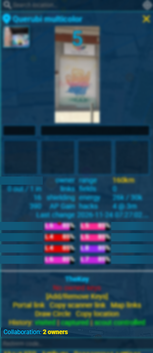
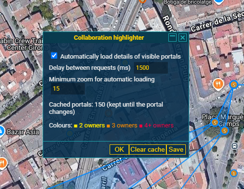

# iitc-collaboration-highlighter-assets

Screenshots for [Collaboration highlighter](https://github.com/Grifwl/iitc-collaboration-highlighter),
an IITC plugin for Ingress that highlights the portals where adding your resonator leaves
2, 3 or 4+ distinct resonator owners.

This repo is kept **public** and separate from the main `iitc-collaboration-highlighter`
source (which is private) so its images can be embedded via `raw.githubusercontent.com`
both in the plugin's own documentation and in its published description on
[iitc.willbe.blue](https://iitc.willbe.blue).

## Contents

- `screenshots/map-highlights.png` — portals highlighted on the map in the three colours
  (2, 3 and 4+ owners).
- `screenshots/portal-details.png` — the portal details panel, blurred except for the
  "Collaboration: 2 owners" line; agent names are fully obscured.
- `screenshots/settings-dialog.png` — the settings window: automatic loading, delay
  between requests, minimum zoom, number of cached portals and the colour legend.

